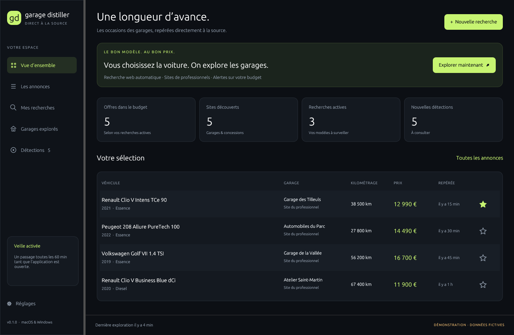

# Garage Distiller

Une application desktop native en **Rust**, pour macOS et Windows, qui découvre des annonces de voitures d’occasion directement sur les sites des garages. Choisissez une marque, un modèle et un budget maximum : la recherche des sites est automatique, sans liste de garages à constituer.

L’interface sombre propose un tableau d’annonces, des recherches enregistrées, des favoris, un historique d’alertes et des notifications système. La découverte web et la collecte s’exécutent en arrière-plan pour garder l’interface réactive.



## Installer l’application

Téléchargez l’archive correspondant à votre ordinateur dans les [versions GitHub](https://github.com/francoispeyret/garage-distiller/releases) : macOS Apple Silicon, macOS Intel ou Windows x64. Décompressez-la, puis ouvrez `Garage Distiller.app` ou `garage-distiller.exe`. Installez-la dans un dossier accessible en écriture pour les mises à jour. Les particularités de signature système sont décrites dans [le guide de distribution](docs/RELEASING.md#installation-et-signature-système).

## Démarrer depuis les sources

Prérequis : [Rust stable et Cargo](https://www.rust-lang.org/tools/install). Sur macOS, installez les outils de compilation Xcode ; sur Windows, utilisez la chaîne Rust MSVC avec les outils de développement C++ de Visual Studio.

```sh
git clone git@github.com:francoispeyret/garage-distiller.git
cd garage-distiller
cargo run --release
```

1. Cliquez sur **Nouvelle recherche** et saisissez, par exemple, `Renault`, `Clio`, `15000`.
2. Lancez l’exploration. Les sources découvertes et leurs éventuelles erreurs apparaissent dans **Garages explorés**.
3. Consultez les annonces correspondantes, filtrez le tableau et ajoutez vos favoris. Ouvrez une annonce pour consulter ses détails et son site d’origine.
4. Dans **Réglages**, choisissez l’intervalle de surveillance et activez les notifications. Autorisez aussi les notifications dans macOS ou Windows. Dans la version portable Windows, elles peuvent apparaître sous le nom Windows PowerShell, utilisé par le service de notifications.

Dans **Les annonces**, les filtres **Électrique uniquement**, **Année min.** et **Année max.** se combinent avec le budget et les favoris. Les années sont inclusives : choisissez la même année aux deux bornes pour une année précise. Les hybrides sont exclus du filtre électrique ; les annonces sans l’énergie ou l’année demandée ne sont pas retenues.

Ces critères sont aussi disponibles à la création ou à la modification d’une recherche et s’appliquent aux notifications. Les recherches enregistrées avant la version 0.1.1 restent utilisables sans nouveaux critères imposés.

Les recherches sont modifiables, désactivables et supprimables. Un garage découvert peut être désactivé. L’ajout manuel d’un site et les sélecteurs CSS restent disponibles en complément pour les sites dont la structure nécessite une adaptation.

La surveillance s’effectue **tant que l’application est ouverte**. Elle n’installe aucun service système. Par défaut, les explorations sont espacées de 60 minutes ; l’intervalle est réglable de 15 minutes à 24 heures.

### Découvrir l’interface sans lancer de collecte

```sh
cargo run -- --demo
```

Ce mode affiche des données **explicitement fictives**. Il ne lit ni n’écrit les données personnelles de l’application et ne lance aucune découverte, collecte ou vérification de mise à jour. Relancez normalement pour utiliser les recherches réelles.

## Fonctionnement de la recherche

Le périmètre initial est la **France**, avec des prix en **euros**. Plusieurs formulations sont soumises à la recherche publique Brave, sans clé obligatoire. DuckDuckGo sert de solution de repli limitée. Les portails d’annonces connus sont exclus des sources candidates ; chaque page retenue est ensuite lue directement sur le site du garage.

Les résultats du moteur servent à trouver des pages. Leurs extraits et leurs prix ne deviennent pas des annonces sans vérification sur le site source. Le collecteur exploite les données structurées JSON-LD, les microdonnées et certaines cartes HTML courantes. Il écarte les offres explicitement vendues, les devises étrangères et les mensualités de financement identifiables.

La correspondance utilise les mots de la marque et du modèle, sans distinction de casse ni d’accents, et un prix inférieur ou égal au budget. Ainsi, `208` ne correspond pas à `2008`. Les variantes commerciales doivent être saisies comme elles apparaissent dans les titres ; une recherche plus courte couvre davantage de versions.

Une alerte est créée pour une nouvelle correspondance ou un prix différent encore compris dans le budget. Une même combinaison recherche–annonce–prix n’est notifiée qu’une fois. Les favoris et la date de première découverte sont conservés lors des mises à jour.

### API Brave facultative

Les moteurs publics peuvent bloquer les requêtes automatisées, limiter leur fréquence ou changer de format. Pour utiliser l’API officielle, renseignez une clé Brave Search dans **Réglages → Découverte web**. La clé saisie reste en mémoire pour la session et n’est pas enregistrée dans `state.json`.

Vous pouvez aussi définir `GARAGE_DISTILLER_BRAVE_API_KEY` dans l’environnement du processus avant le lancement. La clé est transmise uniquement à l’API Brave ; elle n’est pas envoyée aux garages. L’accès à cette API dépend de votre compte et de ses quotas. Voir la [documentation officielle Brave Search](https://api-dashboard.search.brave.com/app/documentation/web-search/get-started).

### Limites explicites

- La découverte dépend de l’index des moteurs : elle ne couvre pas tout le web ni tous les garages.
- Une annonce lue chez un garage peut également être publiée ailleurs. L’application **ne garantit pas son absence sur les grandes plateformes** et n’effectue pas de comparaison exhaustive entre portails.
- Les pages qui nécessitent JavaScript, une connexion ou une vérification anti-bot peuvent être illisibles. Les restrictions `robots.txt` sont respectées ; aucun contournement n’est effectué. Les échecs sont visibles dans l’application.
- Une exploration traite au maximum 60 pages sources, avec trois sites simultanés au maximum. Les pages d’un même domaine sont traitées successivement. Chaque source dispose d’un budget de 60 secondes et peut entraîner la lecture de dix fiches supplémentaires au maximum. Les sources conservées sont revisitées selon leur dernière tentative pour répartir les explorations suivantes.
- Les annonces non revues depuis 48 heures sont masquées par défaut ; le filtre **Archives** permet de les retrouver, et les favoris restent consultables. Les anciennes annonces restent dans l’historique : une page introuvable ou une collecte partielle ne prouve pas qu’un véhicule est vendu. Consultez la date de dernière observation et vérifiez la disponibilité auprès du garage.
- « Bonne affaire » signifie ici « correspond au modèle et au budget ». L’application n’estime pas la cote du véhicule ni son état mécanique.

## Données locales

Les recherches, sources, annonces, favoris, réglages et alertes sont enregistrés dans un fichier JSON local, avec remplacement atomique lors des sauvegardes. Si le fichier devient illisible ou utilise un schéma inconnu, l’application conserve l’original et bloque les écritures au lieu de l’écraser.

| Système | Emplacement de `state.json` |
| --- | --- |
| macOS | `~/Library/Application Support/fr.GarageDistiller.Garage-Distiller/state.json` |
| Windows | `%LOCALAPPDATA%\GarageDistiller\Garage Distiller\data\state.json` |

Le bouton **Ouvrir le dossier de données** dans les réglages permet de retrouver ce fichier. Fermez l’application avant une restauration manuelle.

Il n’y a pas de compte Garage Distiller ni de synchronisation cloud. Les termes de recherche sont envoyés au moteur choisi, les pages sont demandées directement aux garages et GitHub est contacté pour les mises à jour.

## Mises à jour via GitHub

L’application vérifie les [releases du dépôt](https://github.com/francoispeyret/garage-distiller/releases) au démarrage, puis toutes les 24 heures pendant son fonctionnement. Le réglage **Installer automatiquement les mises à jour signées** contrôle l’installation automatique ; une vérification et une installation manuelles sont également disponibles.

Seules les versions stables plus récentes, destinées à la bonne architecture, sont retenues. L’archive est vérifiée par signature Ed25519 et somme SHA-256 avant installation. La nouvelle version devient active à la prochaine ouverture de l’application.

La chaîne de publication et les clés de signature sont configurées dans ce dépôt. Un tag stable correspondant à la version Cargo déclenche les constructions et la publication des trois paquets signés. Une compilation locale sans clé publique intégrée peut vérifier les versions, mais refuse leur installation. Consultez [Publier et mettre à jour Garage Distiller](docs/RELEASING.md) pour la configuration, les signatures et les différences entre signature de mise à jour, notarisation Apple et signature Windows.

Les workflows prévoient macOS Apple Silicon, macOS Intel et Windows x64. Les exécutables doivent être installés dans un dossier accessible en écriture pour permettre leur remplacement.

## Développement et vérification

L’application utilise [egui/eframe](https://docs.rs/eframe/0.33.3/eframe/) pour une interface native écrite en Rust, sans navigateur embarqué.

```sh
cargo fmt --all -- --check
cargo test --locked --all-targets
cargo clippy --locked --all-targets -- -D warnings
cargo build --locked --release
```

Les tests couvrent notamment la correspondance modèle/prix, les alertes sans doublons, la persistance, les réponses de moteurs de recherche, la lecture d’annonces et le refus de mises à jour non conformes. Deux tests de collecte utilisent un serveur HTTP local éphémère sur `127.0.0.1` ; ils nécessitent l’autorisation d’ouvrir un port local si l’environnement de développement est isolé. Aucun test ordinaire ne dépend de la disponibilité d’un garage sur Internet.

Un diagnostic réseau volontaire peut être lancé séparément :

```sh
cargo run --example discover -- Renault Clio 15000 --scan
```

Cette commande effectue de vraies recherches web et, avec `--scan`, lit les trois premières sources découvertes. Ses résultats peuvent varier selon les annonces, l’indexation et les restrictions des moteurs.

Le **14 novembre 2026**, une vérification réelle du collecteur a extrait une **Renault Clio TCe 90 – 21 Intens 2021 à 13 250 €** sur le site [Garage Hoel au Perreux-sur-Marne](https://renault-le-perreux.garagehoel.fr/voitures/occasion/le-perreux-sur-marne/renault/clio/essence/tce-90-21-intens/3515622/). Cette observation documente un test ponctuel ; elle ne garantit ni le prix ni la disponibilité actuelle. Elle n’est pas injectée dans les données de l’application. Les tests locaux ont été exécutés sur macOS ; la matrice GitHub vérifie également Windows et les deux architectures Mac à chaque exécution CI.

| Module | Responsabilité |
| --- | --- |
| `src/ui.rs` | Interface, interactions, notifications et planification |
| `src/discovery.rs` | Découverte de pages de garages par recherche web |
| `src/collector.rs` | Lecture des pages et extraction des annonces |
| `src/engine.rs` | Coordination des collectes et événements de progression |
| `src/model.rs` | Données, correspondances et déduplication des alertes |
| `src/storage.rs` | Sauvegarde et chargement local |
| `src/updater.rs` | Vérification et installation des releases signées |

## Licence

[MIT](LICENSE) — Copyright © 2026 François Peyret.
